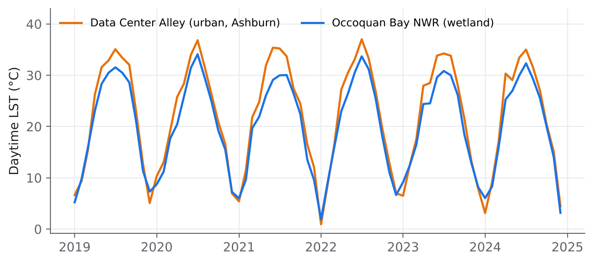
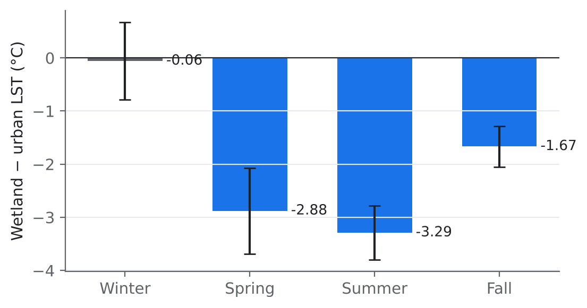
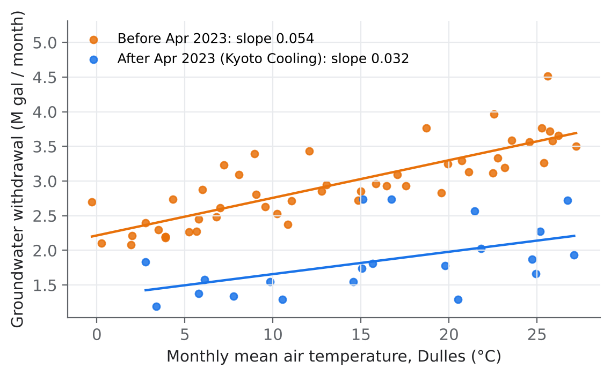
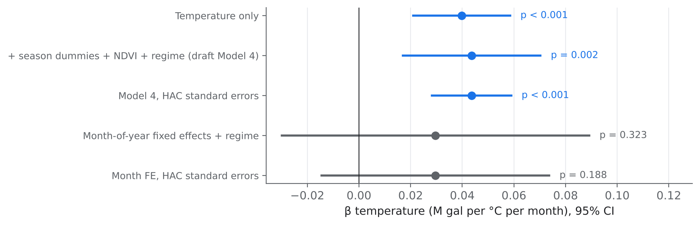

# Wetlands as nature-based cooling infrastructure for water-intensive AI data centers

**Yujia Zou** · Columbia University · working paper (preliminary, not peer reviewed)

**Project page:** https://01wanwu.si

Northern Virginia hosts the world's largest data center cluster, and much of its water use goes to evaporative cooling, which works harder in hot weather. This project asks whether the landscape around a facility, and wetlands in particular, measurably lowers that cooling burden.

## Pilot results

| Study | Question | Data | Main result |
| --- | --- | --- | --- |
| 1 | Is a wetland landscape cooler than the data center core? | MODIS MOD11A2 daytime LST, Occoquan Bay NWR vs. Data Center Alley, 72 months (2019 to 2024) | Wetland cooler by 3.3 °C in summer and 2.9 °C in spring; no gap in winter (site effect F(1,71) = 82.8, p < 0.001; season explains 47% of the gap) |
| 2 | Does heat drive data center water use? | Virginia DEQ monthly well withdrawals at one Prince William County facility, NOAA Dulles temperature, Sentinel-2 NDVI | +0.044 M gal per °C per month with season controls (p = 0.002); not significant with month-of-year fixed effects (β = 0.030, p = 0.32) |

**Limits of the pilot:** one wetland vs. one urban area, one facility, and satellite surface temperature rather than the wet-bulb air temperature that cooling towers respond to. The next phase scales both studies up to address these.

## Next phase (in progress)

- Hundreds of National Wetlands Inventory patches with Landsat 30 m distance rings, plus a MODIS day/night panel (2015 to 2025)
- ERA5-Land wet-bulb temperature at each facility
- Multi-facility DEQ withdrawal panel with facility fixed effects and HAC errors
- Exposure model with Monte Carlo uncertainty and siting scenarios

## Repository

- `code/gee/`: Google Earth Engine scripts for the next phase (run in the Earth Engine Code Editor)
- `code/analysis/make_figures.py`: reproduces Figures 1 to 4 and `figures/study2_robustness.csv`
- `index.html`: the project page (GitHub Pages)

The manuscript and data are available on request.
